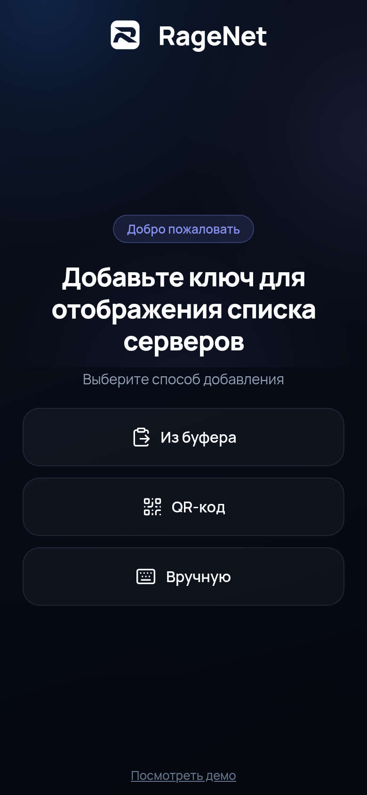
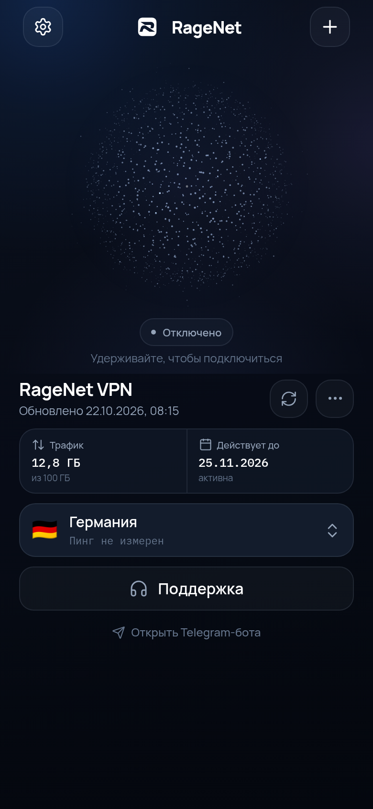
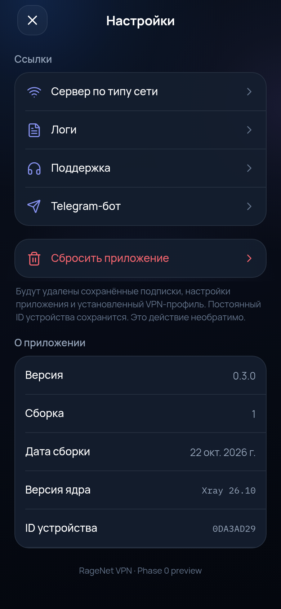

# RageNet VPN app

Кроссплатформенный клиент RageNet на React Native (мобильные) и Tauri + React Native Web (десктоп). Ядро — Xray-core через `libXray`, с встроенным TUN-инбаундом.

> **Статус: Phase 1–2, версия 0.3.19.** Android/iOS уже используют реальный Xray-туннель; iOS-подпись и привилегированный desktop-helper остаются отдельными задачами. План и даты — в [docs/ROADMAP.md](docs/ROADMAP.md), версии — в [docs/VERSIONING.md](docs/VERSIONING.md).

## Что уже работает

- онбординг с добавлением ключа: буфер, QR-заглушка, ручной ввод;
- главный экран с нашей сферой: 1600 частиц, мягкая реакция на палец, удержание, drag и мягкие haptic-тики;
- карточка подписки, трафик, срок действия, выбор сервера, поддержка;
- компактное меню подписки рядом с кнопкой «…»: QR, поделиться, копировать, удалить;
- настройки, логи, сброс, «О приложении»;
- парсер Remnawave-подписок: base64/plain/JSON/full Xray config, заголовки `subscription-userinfo`, `profile-title`, `support-url`, `announce`;
- сборщик Xray-конфига с TUN inbound, DNS и routing-пресетами, без локального API;
- Hysteria2 (`hysteria2://` / `hy2://`) через QUIC/HTTP3-транспорт Xray;
- XHTTP с расширенными `extra`-параметрами из share-ссылок;
- безопасный санитайзер полных Xray-конфигов;
- нативная сфера на SVG-рендерере без тяжёлого Skia-сборки;
- Tauri 2 shell для Windows/macOS/Linux;
- генератор иконок из брендового логотипа;
- unit-тесты парсера, конфига и Xray-сборщика.

## Превью

| Онбординг                                 | Главный экран                 | Настройки                             |
| ----------------------------------------- | ----------------------------- | ------------------------------------- |
|  |  |  |

## Быстрый старт

```bash
pnpm install
pnpm web          # Expo web, http://localhost:8081
pnpm test
pnpm typecheck
pnpm build:web
```

## Структура

```
apps/
  mobile/        Expo React Native (Android/iOS)
  desktop/       Tauri 2 shell поверх Expo web build
packages/
  design/        токены, шрифты, темы
  core/          подписки, Remnawave-заголовки, Xray-конфиг, HWID
  vpn/           контракт native bridge + mock
  particles/     симуляция сферы
  ui/            экраны, компоненты, store
native/
  android/       контракт VpnService + libXray
  ios/           контракт Packet Tunnel + LibXray
  desktop/       контракт Xray sidecar + helper
tools/
  generate-icons.py
```

## Документация

- [Roadmap и даты](docs/ROADMAP.md)
- [Архитектура](docs/ARCHITECTURE.md)
- [Версионирование и релизы](docs/VERSIONING.md)
- [Сборки в GitHub Actions](docs/BUILDS.md)
- [Подпись и дистрибуция](docs/SIGNING.md)
- [Phase 0: что сделано](docs/PHASE0.md)

## Команды

```bash
pnpm dev                      # Expo dev server
pnpm web                      # Expo web
pnpm android                  # Expo Android
pnpm ios                      # Expo iOS (macOS)
pnpm build:web                # статический web export в apps/mobile/dist
pnpm --filter @ragenet/desktop dev   # Tauri dev (нужен Rust)
pnpm --filter @ragenet/desktop build # Tauri build
```

## Проверки

```bash
pnpm version:check
pnpm format:check
pnpm typecheck
pnpm test
```

CI: `.github/workflows/ci.yml` — типы, тесты, prettier и web build на каждый push/PR.

## Сборки

- Android: универсальный APK должен быть **подписан**. «Неподписанный APK» нельзя установить; CI собирает self-signed Release APK со встроенным JS-бандлом.
- iOS: unsigned IPA собирается, но VPN-extension не запустится без платного Apple Developer Program и entitlement `packet-tunnel-provider`.
- macOS: для полноценного TUN нужен привилегированный helper; для распространения — Developer ID + notarization.
- Windows: EXE будет без подписи, пока не добавлен code-signing сертификат.

Подробности: [docs/SIGNING.md](docs/SIGNING.md).

## Лицензия

AGPL-3.0. Xray-core распространяется под MPL-2.0, libXray — под MIT. Сторонние лицензии и attribution добавляются в `THIRD_PARTY_NOTICES.md` перед первым релизом.
